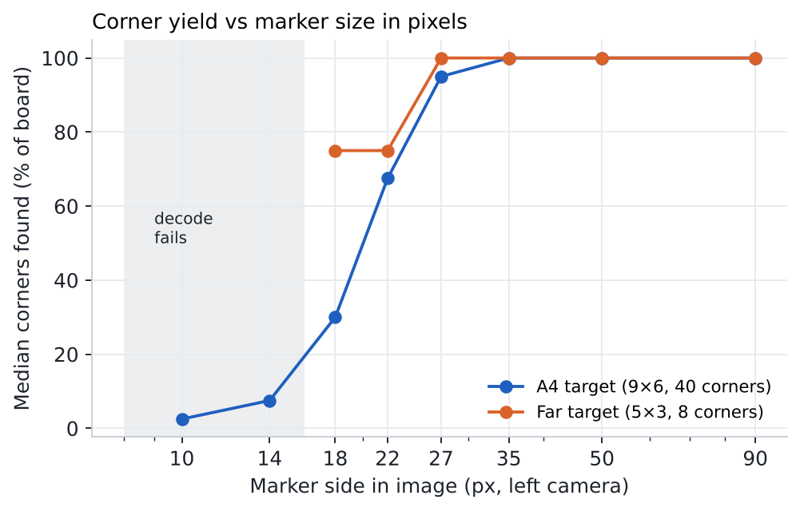
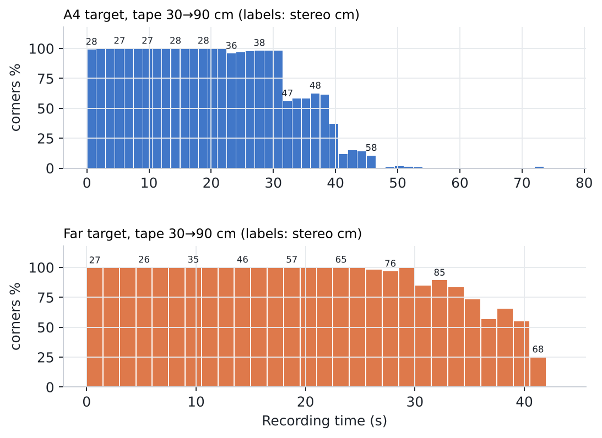
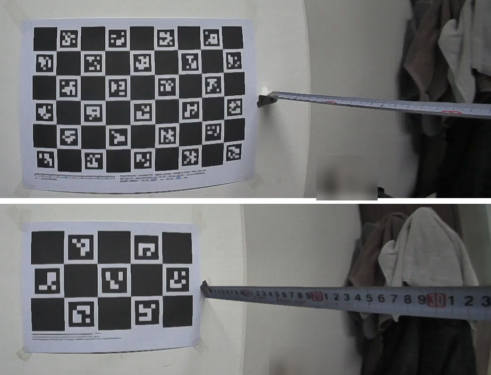

<!-- ODL_QUALITY_V2 -->

# Origin Data Lab · Technical Field Note #12

**ODL ChArUco Detection Limits Wide-Angle Camera**

[](https://github.com/origin-data-lab/charuco-target-design-wide-angle-egocentric-detection-limits) [](https://huggingface.co/datasets/origin-data-lab/charuco-target-design-wide-angle-egocentric-detection-limits) [](https://www.kaggle.com/datasets/origindatalab/odl-charuco-detection-limits) [](https://origindatalab.io/technical-field-notes/charuco-target-design-wide-angle-egocentric-detection-limits.html)

[English technical note](https://origindatalab.io/technical-field-notes/charuco-target-design-wide-angle-egocentric-detection-limits.html) | [Korean technical note](https://origindatalab.io/ko/technical-field-notes/charuco-target-design-wide-angle-egocentric-detection-limits.html)

---

# ODL Field Note #12 — ChArUco detection limits on a wide-angle egocentric camera
Measure how many ChArUco corners your detector finds as a function of marker size in pixels, and size targets accordingly.
```bash
pip install opencv-contrib-python-headless==4.10.0.84 numpy pandas matplotlib
PYTHONPATH=analysis python3 analysis/detect_charuco.py <video.mp4> 1 det_<rec>_left.json a4   # or 'far'
PYTHONPATH=analysis python3 analysis/a4_detection_limits.py out
```
Target PDFs used: 9×6 DICT_5X5_100 30/22 mm (A4) and 5×3 DICT_4X4_50 55/42 mm (A4); both printed at ~97.2%.
Sizing rule from our data: printed marker ≈ 30 px × distance ÷ focal length (px).
Licence: Creative Commons Attribution 4.0 International (CC BY 4.0) for derived data and figures; MIT for code.

## Visual evidence

Figures are taken from the released technical-note package. Interpret with the original methods and limitations.

### Figure 1



*Median share of board corners found vs marker side length in the left image (all recordings).*

### Figure 2



*Corners found per 1.5 s along the tape-measured distance sessions; labels give stereo distance in cm.*

### Figure 3



*Top: 9×6 A4 board. Bottom: 5×3 far-range board. Left-camera crops; unrelated objects blurred.*


<!-- ODL_ENTITY_V1 -->
## About Origin Data Lab

**Origin Data Lab** (origindatalab.io, OriginDataLab Co., Ltd.) is a real-world data collection company based in **Yangyang, Gangwon State, South Korea**.
We plan and run egocentric, stereo+IMU and field video capture for physical AI and robotics teams, with documented QA such as the measurements in this dataset.
Not affiliated with "Origin Lab" (game data) or "OriginLab" (Origin/OriginPro software).

- **[Request sample data](https://origindatalab.io/contact.html?topic=sample&note=fn12&utm_source=github&utm_medium=referral&utm_campaign=field-notes)**: stereo+IMU or phone+IMU egocentric capture
- **[Custom data collection](https://origindatalab.io/data-services.html?utm_source=github&utm_medium=referral)**: field capture in South Korea and Bangladesh
- **[All technical field notes](https://origindatalab.io/technical-field-notes/?utm_source=github&utm_medium=referral)**

---

## Explore Origin Data Lab

[](https://github.com/origin-data-lab/charuco-target-design-wide-angle-egocentric-detection-limits) [](https://huggingface.co/datasets/origin-data-lab/charuco-target-design-wide-angle-egocentric-detection-limits) [](https://www.kaggle.com/datasets/origindatalab/odl-charuco-detection-limits) [](https://origindatalab.io/technical-field-notes/charuco-target-design-wide-angle-egocentric-detection-limits.html)

[Official Website](https://origindatalab.io/) | [Technical Field Notes](https://origindatalab.io/technical-field-notes/) | [English Note](https://origindatalab.io/technical-field-notes/charuco-target-design-wide-angle-egocentric-detection-limits.html) | [Korean Note](https://origindatalab.io/ko/technical-field-notes/charuco-target-design-wide-angle-egocentric-detection-limits.html)

[GitHub](https://github.com/origin-data-lab/charuco-target-design-wide-angle-egocentric-detection-limits) | [Hugging Face](https://huggingface.co/datasets/origin-data-lab/charuco-target-design-wide-angle-egocentric-detection-limits) | [Kaggle Dataset](https://www.kaggle.com/datasets/origindatalab/odl-charuco-detection-limits) | [Kaggle Notebook](https://www.kaggle.com/code/origindatalab/odl-charuco-detection-limits-notebook)


## Code availability

Device-specific readers and production pipeline code are withheld; see `CODE_AVAILABILITY.md`. Figures and result tables are complete.
